# Praktikum 4 – Box Element dan Layout Web Sederhana (Pemrograman Web)

| | |
|---|---|
| **Nama** | Riksa Siddiq Alrizki |
| **NIM** | 312510015 |
| **Kelas** | I253A |
| **Program Studi** | Teknik Informatika |
| **Mata Kuliah** | Pemrograman Web |
| **Universitas** | Universitas Pelita Bangsa |

---

## 1. Tujuan Praktikum

1. Memahami box element (`div`) dan properti `float` pada CSS.
2. Memahami penggunaan properti `clear` untuk mengatur elemen setelah elemen yang di-*float* (clearfix).
3. Membuat layout web sederhana menggunakan semantic element HTML5 (`header`, `nav`, `section`, `aside`, `footer`) dan CSS.
4. Membuat halaman tambahan (About dan Kontak) dengan layout yang sama.

## 2. Struktur Folder

```
Lab4Web/
├── lab4_box.html      (latihan box element, float, clear)
├── home.html          (layout sederhana)
├── about.html         (tugas 1: halaman About)
├── kontak.html        (tugas 2: halaman Kontak)
├── style.css          (CSS layout)
├── screenshoot/       (1.png - 12.png)
└── README.md
```

---

## 3. Bagian A – Box Element, Float, dan Clearfix (`lab4_box.html`)

### Langkah 1 – Persiapan dokumen HTML

Dibuat file `lab4_box.html` dengan kerangka HTML dasar. Di dalam `body` terdapat `header` berisi judul `<h1>Box Element</h1>`.

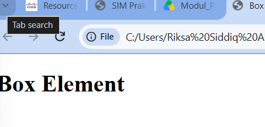

### Langkah 2 – Membuat box element dengan tag `div`

Ditambahkan tiga `div` di dalam `section`:

```html
<section>
  <div class="div1">Div 1</div>
  <div class="div2">Div 2</div>
  <div class="div3">Div 3</div>
</section>
```

**Hasil:** karena `div` adalah *block element*, ketiganya tersusun ke bawah, satu elemen per baris.

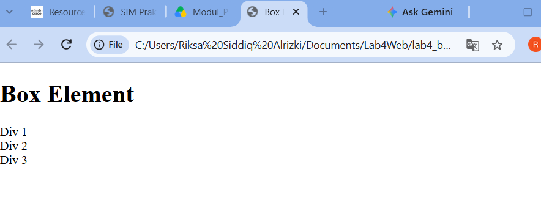

### Langkah 3 – CSS Float

```html
<style>
  div {
    float: left;
    padding: 10px;
  }
  .div1 { background: red; }
  .div2 { background: yellow; }
  .div3 { background: green; }
</style>
```

**Penjelasan:**

- `float: left` membuat elemen "mengambang" ke kiri sehingga elemen berikutnya bisa berada di sebelah kanannya.
- `padding: 10px` memberi jarak di dalam setiap kotak.
- `.div1`, `.div2`, `.div3` memberi warna latar merah, kuning, dan hijau.

**Hasil:** ketiga box kini berjajar menyamping dari kiri ke kanan.

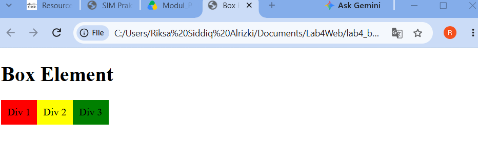

### Langkah 4 – Clearfix dengan properti `clear`

Ditambahkan elemen `div4` setelah `div3`:

```html
<div class="div4">Div 4</div>
```

```css
.div4 {
  background-color: blue;
  clear: left;
  float: none;
}
```

**Penjelasan:**

- `clear: left` membuat `div4` tidak boleh berada di sisi kanan elemen yang di-*float* ke kiri, sehingga ia turun ke baris baru di bawahnya.
- `float: none` mengembalikan `div4` menjadi elemen block biasa. Karena itu lebarnya memenuhi satu baris penuh.

**Hasil:** Div 1 sampai Div 3 berjajar, sedangkan Div 4 (biru) berada di bawahnya dengan lebar penuh.

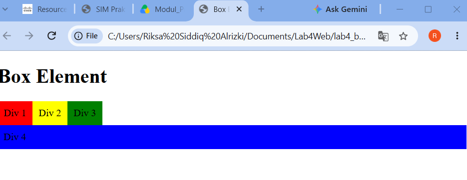

**Nilai properti `clear`:**

| Nilai | Fungsi |
|---|---|
| `left` | Elemen turun di bawah elemen yang di-float ke kiri |
| `right` | Elemen turun di bawah elemen yang di-float ke kanan |
| `both` | Elemen turun di bawah elemen yang di-float ke kiri maupun kanan |
| `none` | Default, elemen boleh berada di samping elemen float |

---

## 4. Bagian B – Layout Web Sederhana (`lab4_layout`)

Layout dibuat dengan dua file: `home.html` dan `style.css` yang dihubungkan lewat `<link rel="stylesheet" href="style.css">`.

### Langkah 1 – Kerangka layout dengan semantic element

```html
<div id="container">
  <header>...</header>
  <nav>...</nav>
  <section id="hero"></section>
  <section id="wrapper">
    <section id="main"></section>
    <aside id="sidebar"></aside>
  </section>
  <footer>...</footer>
</div>
```

| Elemen | Fungsi |
|---|---|
| `header` | Bagian kepala halaman (judul situs) |
| `nav` | Menu navigasi (Home, Artikel, About, Kontak) |
| `section#hero` | Panel utama/banner |
| `section#wrapper` | Pembungkus area `main` dan `sidebar` |
| `section#main` | Konten utama |
| `aside#sidebar` | Kolom samping (widget) |
| `footer` | Bagian kaki halaman |

**Hasil sebelum diberi CSS:** elemen hanya tersusun ke bawah dengan gaya bawaan browser.

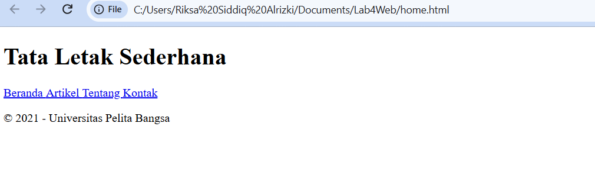

### Langkah 2 – Reset CSS, body, container, dan header

```css
* { margin: 0; padding: 0; }
body {
  line-height: 1;
  font-size: 100%;
  font-family: 'Open Sans', sans-serif;
  color: #5a5a5a;
}
#container {
  width: 980px;
  margin: 0 auto;
  box-shadow: 0 0 1em #cccccc;
}
header { padding: 20px; }
header h1 { margin: 20px 10px; color: #b5b5b5; }
```

**Penjelasan:**

- `* { margin: 0; padding: 0; }` menghapus margin dan padding bawaan semua elemen agar tampilan konsisten di semua browser.
- `body` mengatur font *Open Sans* (diimpor dari Google Fonts lewat `@import`) dan warna teks abu-abu tua.
- `#container` membatasi lebar halaman 980px, rata tengah (`margin: 0 auto`), dan diberi bayangan (`box-shadow`).
- `header` dan `header h1` memberi jarak serta warna abu-abu muda pada judul.

**Hasil:** judul berwarna abu-abu dengan font sans-serif.

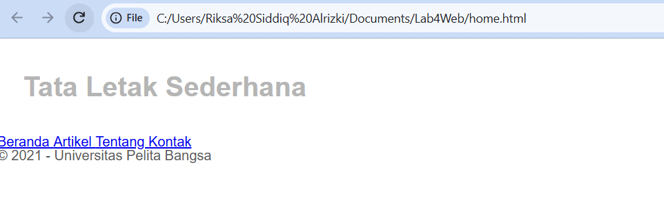

### Langkah 3 – Navigasi

```css
nav {
  display: block;
  background-color: #1f5faa;
}
nav a {
  padding: 15px 30px;
  display: inline-block;
  color: #ffffff;
  font-size: 14px;
  text-decoration: none;
  font-weight: bold;
}
nav a.active,
nav a:hover {
  background-color: #2b83ea;
}
```

**Penjelasan:** `nav` diberi latar biru. Tautan `nav a` dijadikan `inline-block` agar padding 15px 30px berlaku dan menu tampil seperti tombol. Menu aktif (`.active`) serta menu yang disorot kursor (`:hover`) berwarna biru lebih terang.

**Hasil:** menu navigasi tampil sebagai bar biru dengan teks putih tebal. Menu pertama tampak aktif.

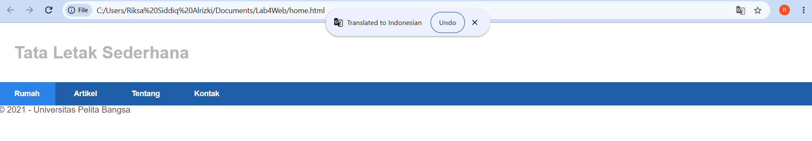

### Langkah 4 – Hero Panel

```html
<section id="hero">
  <h1>Hello World!</h1>
  <p>Lorem ipsum dolor sit amet, ...</p>
  <a href="home.html" class="btn btn-large">Learn more &raquo;</a>
</section>
```

```css
#hero {
  background-color: #e4e4e5;
  padding: 50px 20px;
  margin-bottom: 20px;
}
#hero h1 { margin-bottom: 20px; font-size: 35px; }
#hero p  { margin-bottom: 20px; font-size: 18px; line-height: 25px; }
```

**Penjelasan:** hero panel diberi latar abu-abu `#e4e4e5`, padding besar (50px atas-bawah), dan margin bawah 20px. Judul berukuran 35px, paragraf 18px dengan jarak antar baris 25px.

**Hasil:**

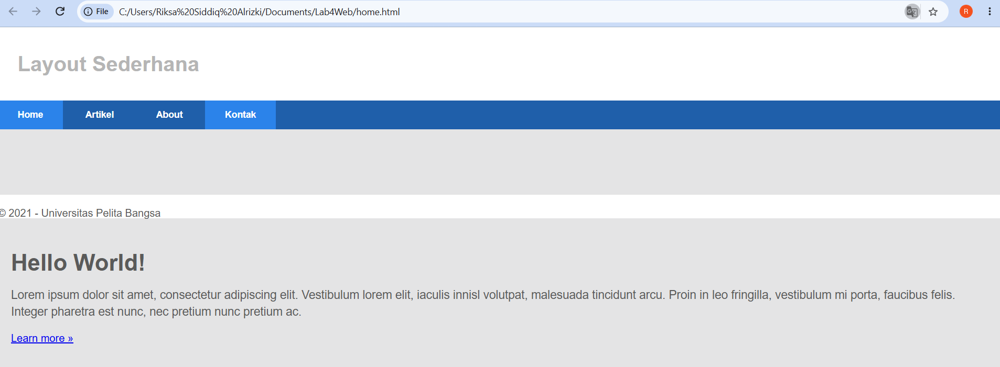

### Langkah 5 – Main content dan Sidebar (float)

```css
#wrapper { margin: 0; }
#main    { float: left; width: 640px; padding: 20px; }
#sidebar { float: left; width: 260px; padding: 20px; }
```

**Penjelasan:** `#main` (640px) dan `#sidebar` (260px) sama-sama di-*float* ke kiri sehingga berdampingan. Total lebar 640 + 260 + padding 4 × 20px = 980px, pas dengan lebar `#container`.

### Langkah 6 – Sidebar widget

Di dalam `aside#sidebar` ditambahkan dua `div.widget-box`: widget daftar tautan dan widget teks.

```css
.widget-box { border: 1px solid #eee; margin-bottom: 20px; }
.widget-box .title {
  padding: 10px 16px;
  background-color: #428bca;
  color: #fff;
}
.widget-box ul { list-style-type: none; }
.widget-box li { border-bottom: 1px solid #eee; }
.widget-box li a {
  padding: 10px 16px;
  color: #333;
  display: block;
  text-decoration: none;
}
.widget-box li:hover a { background-color: #eee; }
.widget-box p { padding: 15px; line-height: 25px; }
```

**Penjelasan:** judul widget berlatar biru, daftar tautan tanpa bullet dan dipisah garis tipis, dan tiap tautan dijadikan `display: block` agar seluruh baris bisa diklik dan berubah abu-abu saat di-hover.

**Hasil:**

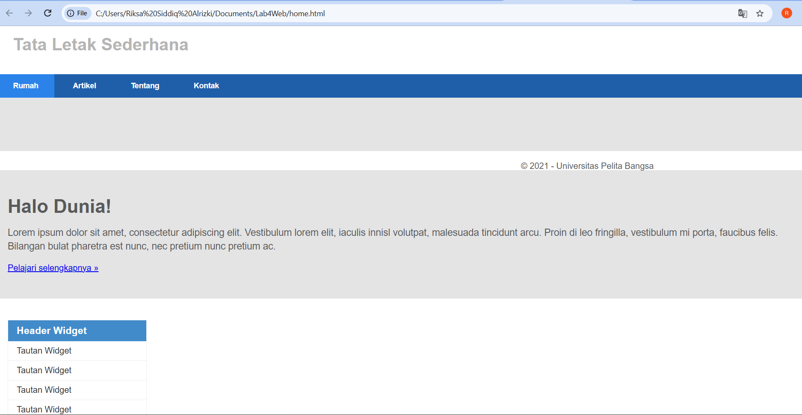

### Langkah 7 – Footer

```css
footer {
  clear: both;
  background-color: #1d1d1d;
  padding: 20px;
  color: #eee;
}
```

**Penjelasan:** `clear: both` penting karena `#main` dan `#sidebar` di-*float*. Tanpa clear, footer akan naik dan menempel di sisi elemen float. Footer diberi latar hitam keabu-abuan dengan teks terang.

### Langkah 8 – Box content di Main

Ditambahkan tiga `div.box` di dalam `div.row` pada `#main`. Setiap box berisi gambar bulat, heading, paragraf, dan tombol "View detail".

```css
.box {
  display: block;
  float: left;
  width: 33.333333%;
  box-sizing: border-box;
  padding: 0 10px;
  text-align: center;
}
.box h3 { margin: 15px 0; }
.box p  { line-height: 20px; font-size: 14px; margin-bottom: 15px; }
.image-circle { border-radius: 50%; }
.row { margin: 0 -10px; box-sizing: border-box; }
.row:after, .row:before,
.entry:after, .entry:before { content: ''; display: table; }
.row:after, .entry:after { clear: both; }
```

**Penjelasan:**

- `width: 33.333333%` membagi lebar menjadi tiga kolom sama besar.
- `box-sizing: border-box` membuat padding dihitung di dalam lebar, sehingga tiga box tidak turun ke baris baru.
- `border-radius: 50%` membuat gambar berbentuk lingkaran.
- `.row { margin: 0 -10px; }` meniadakan padding kiri-kanan box di tepi baris.
- Aturan `.row:after { clear: both; }` adalah teknik **clearfix**: elemen semu (`content: ''; display: table`) ditambahkan lalu di-clear agar pembungkus ikut menyesuaikan tinggi elemen float di dalamnya.

**Hasil:** tiga box berjajar di kolom utama, di samping sidebar.

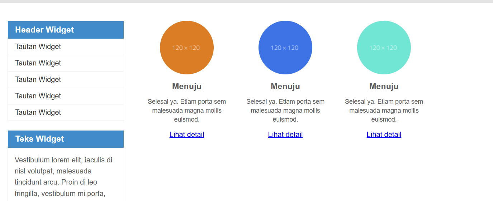

### Langkah 9 – Content artikel

Ditambahkan elemen `hr.divider` dan dua `article.entry` pada `#main`. Artikel pertama gambar berada di kiri, artikel kedua gambar di kanan (`class="right-img"`).

```css
.divider { border: 0; border-top: 1px solid #eeeeee; margin: 40px 0; }
.entry { margin: 15px 0; }
.entry h2 { margin-bottom: 20px; }
.entry p { line-height: 25px; }
.entry img { float: left; border-radius: 5px; margin-right: 15px; }
.entry .right-img { float: right; }
```

**Penjelasan:** gambar di dalam artikel di-*float* ke kiri sehingga teks mengalir di sebelahnya. Class `.right-img` mengubahnya menjadi float ke kanan.

---

## 5. Tugas

### Tugas 1 – Layout halaman About


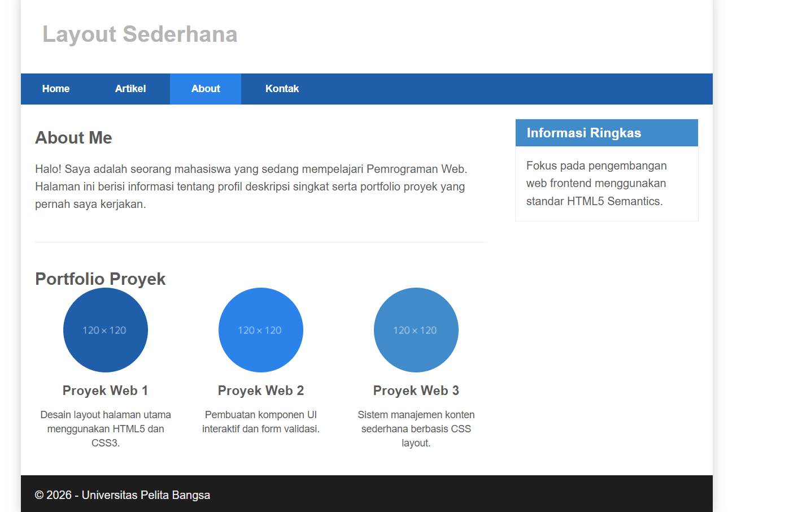

### Tugas 2 – Layout halaman Kontak

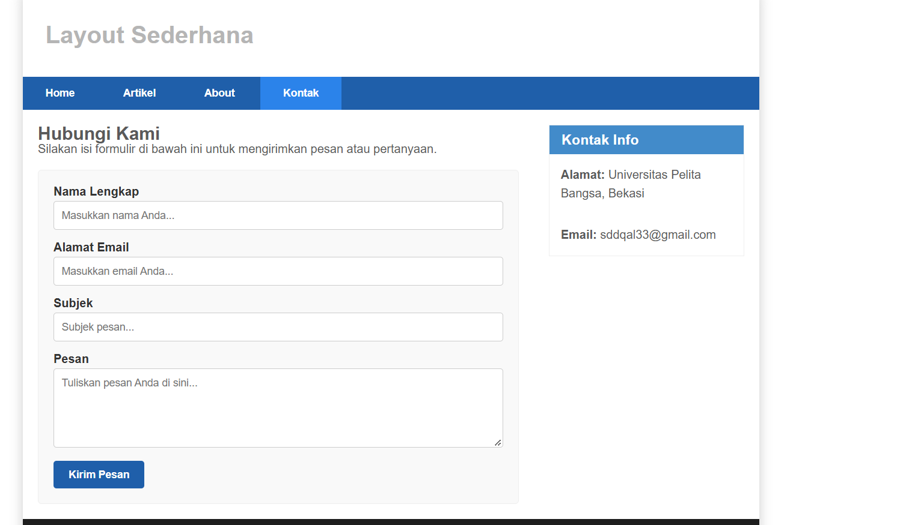

---

## 6. Kesimpulan

Pada praktikum ini dipelajari bahwa `float` dapat dipakai untuk menyusun elemen secara horizontal, dan elemen setelahnya dikendalikan dengan `clear`. Untuk layout multi-kolom, lebar elemen harus dihitung dengan cermat (atau memakai `box-sizing: border-box`) agar kolom tidak turun ke baris berikutnya. Teknik clearfix (`:after` dengan `clear: both`) membuat elemen pembungkus mengikuti tinggi elemen float di dalamnya. Dengan semantic element HTML5 dan CSS, halaman web dapat dibuat terstruktur dengan header, navigasi, konten utama, sidebar, dan footer, lalu dipakai ulang untuk halaman lain seperti About dan Kontak.
